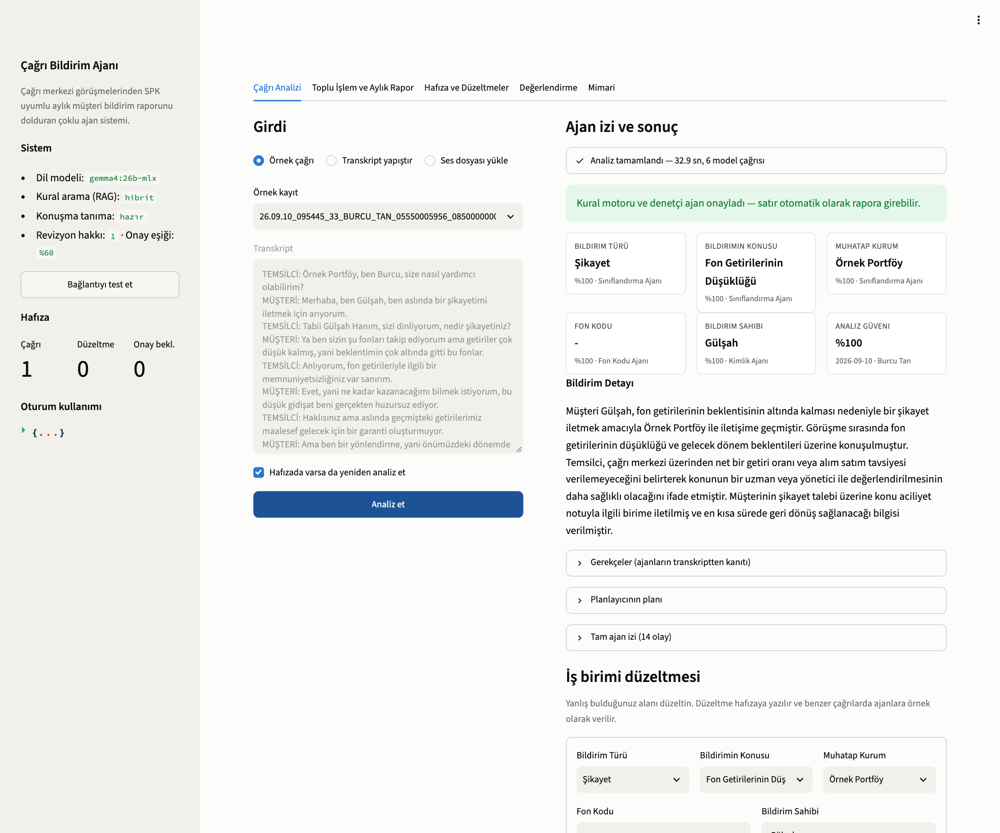
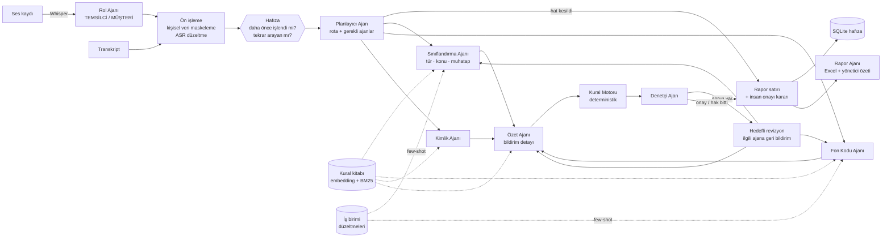
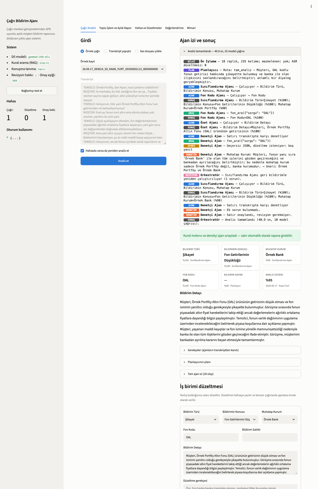
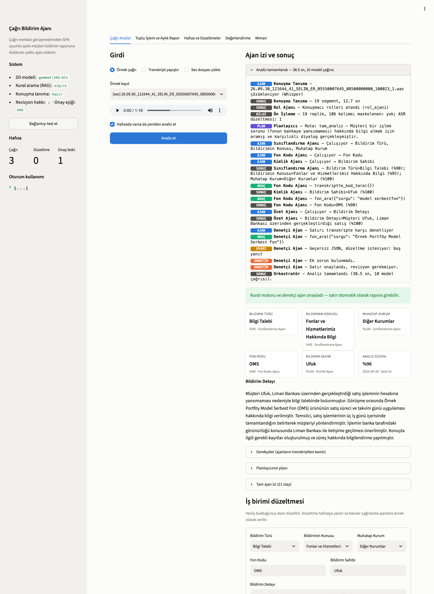
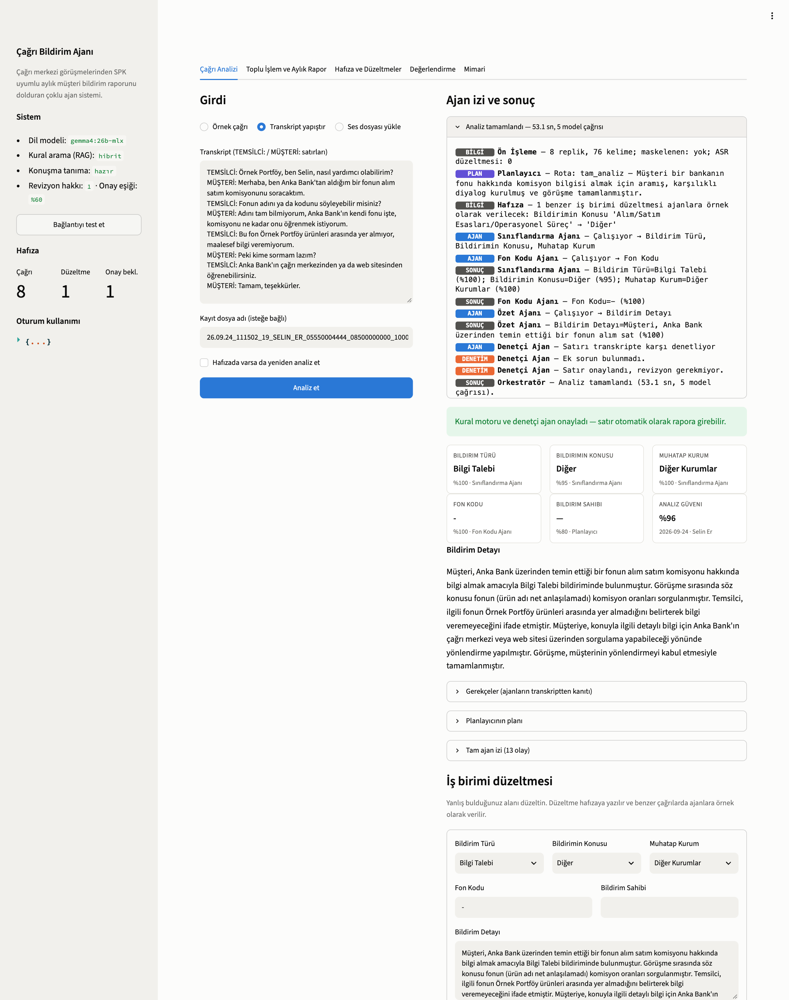
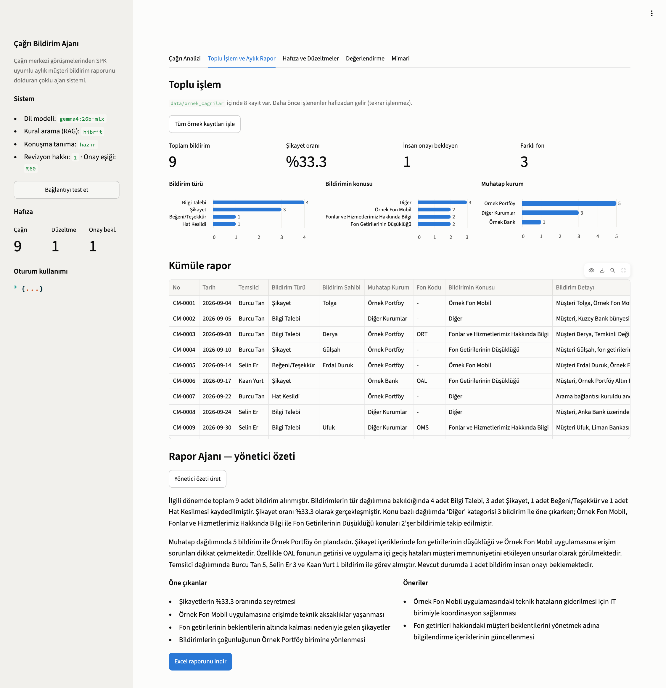
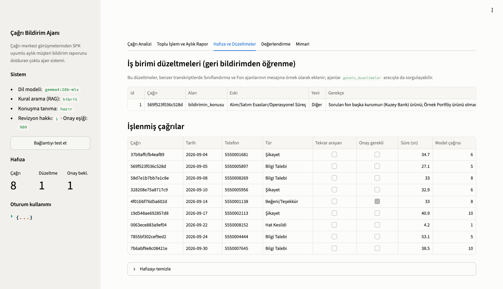
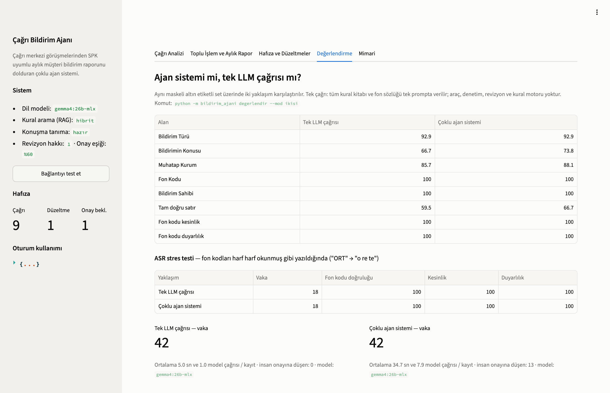
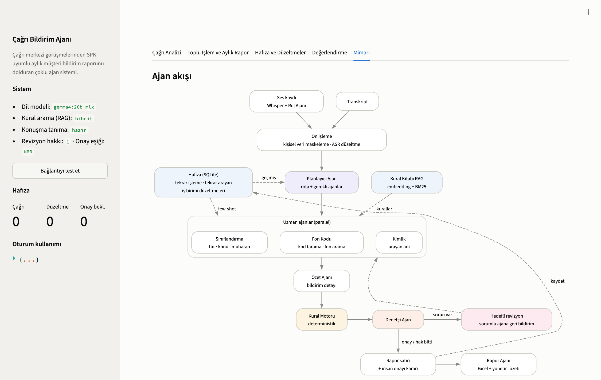

# Çağrı Bildirim Ajanı

Bir portföy yönetim şirketinin çağrı merkezine gelen telefon görüşmelerinden, Sermaye Piyasası
mevzuatının istediği **aylık müşteri bildirim raporunu** otomatik dolduran çoklu ajan sistemi.

Ses kaydı ya da transkript girer. Planlayıcı, uzman ajanlar, kural motoru ve denetçi birlikte
çalışır; sonunda Excel'e hazır bir rapor satırı ve gerekiyorsa "insan onayı gerekli" işareti çıkar.

> Proje, gerçek bir kurumda yürüttüğüm bir uygulamanın maskelenmiş ve yeniden yazılmış hâlidir.
> Kurum adı, fon kodları, temsilciler, müşteriler ve telefonlar kurmacadır (**Örnek Portföy
> Yönetimi A.Ş.**). Değerlendirme setinin etiketleri gerçek iş birimi onaylı rapordan maskelenerek
> alınmıştır (ayrıntı: [Veri ve maskeleme](#veri-ve-maskeleme)).



---

## İçindekiler

1. [Problem](#problem)
2. [Neden agentic yaklaşım?](#neden-agentic-yaklaşım)
3. [Mimari](#mimari)
4. [Kullanılan teknolojiler](#kullanılan-teknolojiler)
5. [Kurulum](#kurulum)
6. [Çalıştırma](#çalıştırma)
7. [Değerlendirme sonuçları](#değerlendirme-sonuçları)
8. [Ekran görüntüleri](#ekran-görüntüleri)
9. [Hata ve belirsizlik yönetimi](#hata-ve-belirsizlik-yönetimi)
10. [Veri ve maskeleme](#veri-ve-maskeleme)
11. [Proje yapısı](#proje-yapısı)
12. [Sınırlamalar ve sonraki adımlar](#sınırlamalar-ve-sonraki-adımlar)

---

## Problem

Portföy yönetim şirketleri, müşterilerden gelen her talep, şikayet ve öneriyi aylık bir
**bildirim raporuna** işlemek zorundadır. Rapordaki her satırda şu alanlar doldurulur:

| Alan | Örnek değer | Neden zor? |
|---|---|---|
| Bildirim Türü | Bilgi Talebi / Şikayet / Öneri / Beğeni / Hat Kesildi / Diğer | "Satamıyorum" bazen şikayet, bazen sadece soru. Kapanıştaki "teşekkürler" beğeni sayılmaz. |
| Bildirimin Konusu | 6 sabit kategoriden biri | Öncelik sırası var: getiri şikayeti, danışmanlık talebinin önüne geçer. |
| Muhatap Kurum | Örnek Portföy / Örnek Bank / Örnek Yatırım / Diğer Kurumlar | Muhatap arayanın kurumu değil, konunun sahibidir. Fon başka bankadan alındıysa muhatap değişir. |
| Fon Kodu | `ORT, OAL` veya `-` | Müşteri kodu harf harf söyler ("o re te"). Konuşma tanıma "ORT"yi "ÖRT" yazar. Sözlükte olmayan kod yazılamaz. |
| Bildirim Sahibi | Arayanın adı | Temsilcinin adı müşteri adı sanılmamalı. Ad söylenmediyse alan boş kalır. |
| Bildirim Detayı | 4-7 cümlelik resmi özet | İlk cümle türü göstermeli. Uydurma bilgi ve kişisel veri içermemeli. |

Gerçek kurumda bu iş ayda yaklaşık 300 kayıt için **elle**, kayıtlar tek tek dinlenerek
yapılıyordu. İş birimi beş geri bildirim turunda 40'tan fazla kural ve istisna tanımladı.
Örneğin "Garanti" bir banka adıdır ama "garanti getiri" ifadesinde banka değildir; özel fonlar
da sahibinin soyadını taşır.

## Neden agentic yaklaşım?

Bunu iddia etmek yerine ölçtüm. Karşılaştırmadaki rakip, güçlü bir tek LLM çağrısı: transkript,
kural kitabının tamamı ve fon sözlüğü tek prompta veriliyor. Bu yöntem temiz transkriptlerde
kategorik alanlarda ajan sistemine yakın sonuç veriyor
([Değerlendirme sonuçları](#değerlendirme-sonuçları)). Yani bu sette doğruluk farkı tek başına
ajan mimarisini gerekçelendirmiyor.

Gerekçe, bir uyum raporunun **operasyonel ihtiyaçlarından** geliyor. Bunları tek çağrı
karşılayamıyor:

1. **Garanti, olasılık değil.** Tek çağrı bu sette izinli liste dışında kategori ya da sözlükte
   olmayan fon kodu üretmedi, ama bunun bir güvencesi yok. Gerçek kayıtlarda konuşma tanıma
   kodları "Ö" ile başlatıyor, temsilci adı müşteri adı sanılıyor, transkriptte telefon ve TC
   kimlik numarası geçiyor. Şu bileşenler, model ne üretirse üretsin rapora giren değerin kurala
   uymasını sağlıyor:
   - fon sözlüğü **aracı**,
   - deterministik **kural motoru**,
   - **kişisel veri maskeleme**.
2. **Alan bazında kanıt ve iz.** Uyum ekibi her alanın neden öyle doldurulduğunu görmek
   zorundadır. Her ajan transkriptten gerekçe ve güven puanı verir; plan, araç çağrıları,
   denetim ve revizyon adım adım kaydedilir.
3. **Belirsizliği insana yönlendirme.** Denetçi Ajan ve kural motoru çözemedikleri tutarsızlığı
   önce sorumlu ajana geri gönderir. Revizyondan sonra da çözülmezse satırı gerekçesiyle
   **insan onayına** ayırır. Tek çağrı ise her satırı aynı güvenle verir.
4. **Hafıza.** Aynı kayıt tekrar işlenmez. Aynı numaradan tekrar şikayet gelirse işaretlenir.
   İş birimi düzeltmeleri benzer çağrılarda ajanlara örnek olarak verilir; gerçek projede
   kurallar 5 geri bildirim turunda elle güncellenmişti.
5. **Ölçek.** Gerçek kural kitabı yüzlerce satır, gerçek fon sözlüğü 200'den fazla koddur.
   Hepsini her çağrıda prompta koymak hem yavaş hem pahalıdır. Gerçek projede yalnız fon
   sözlüğü bölümü yaklaşık 16 bin token tutuyordu; ön filtrelemeyle yaklaşık 3 bin token'a
   indi. Burada aynı sorun alan bazlı kural getirme (RAG) ve sözlüğün araçla sorgulanmasıyla
   çözülüyor.

## Mimari



### Ajanlar

| Ajan | Sorumluluk | Araçlar |
|---|---|---|
| **Planlayıcı** | İçerik yoksa (hat kesildi) modeli hiç çağırmadan kısa yoldan çıkar. Fon veya kimlik analizi gerekmiyorsa o ajanları atlar. Diğer ajanlara "başka banka kanalı geçiyor", "kod harf harf söylenmiş" gibi dikkat notları bırakır. | — |
| **Sınıflandırma** | Bildirim türü, konu ve muhatap kurum | `kural_ara`, `gecmis_duzeltmeler` |
| **Fon Kodu** | Konuşulan fonların kodları | `transkriptte_kod_tara`, `fon_ara`, `ozel_fon_sahibi_kontrol`, `kural_ara` |
| **Kimlik** | Arayanın adı; temsilci adını eler | `temsilci_mi` |
| **Özet** | Bildirim detayı paragrafı. Diğer ajanların kararlarıyla tutarlı yazar. | — |
| **Denetçi** | Satırı transkripte karşı denetler, kanıtlı sorun listesi döndürür | `kural_ara`, `fon_ara` |
| **Rol Ajanı** | Ses kaydında her segmenti temsilci ya da müşteri olarak etiketler. Ayrı bir konuşmacı ayrıştırma modeli gerekmez. | — |
| **Rapor Ajanı** | Aylık istatistikten yönetici özeti yazar. Özetteki her sayı istatistikle karşılaştırılır. | — |

### Agentic bileşenler nerede?

- **Planlama:** `PlanlayiciAjan` (`bildirim_ajani/agents/ajanlar.py`) ve orkestratörün
  deterministik ön kontrolü (`orchestrator.py::_planla`).
- **Araç kullanımı (function calling):** 6 araç, `bildirim_ajani/tools.py`. Her araç JSON
  şemasıyla modele tanıtılır. Hata verirse ajana `{"hata": ...}` döner, döngü kırılmaz.
- **ReAct döngüsü:** `agents/base.py`. Akış: düşün, araç çağır, gözlemle, karar ver. Adım
  sınırı vardır; sınır dolunca araçsız son karar istenir.
- **Hafıza:**
  - Kısa süreli: çağrı durumu ve ajanlar arası kararlar.
  - Uzun süreli (`memory.py`, SQLite):
    - İşlenen kayıt tekrar işlenmez (idempotency).
    - Aynı numaradan tekrar arayan tespit edilir. Tekrarlayan şikayet insan onayına düşer.
    - İş birimi düzeltmeleri saklanır, benzer çağrılarda ajana örnek olarak verilir.
- **RAG:** kural kitabı (`knowledge/kurallar.md`) kural kural parçalanır ve her parça ait
  olduğu rapor alanıyla etiketlenir. Her ajan:
  - kendi alanının kurallarını meta veri filtresiyle eksiksiz alır,
  - diğer alanlardan transkripte en ilgili kuralları hibrit aramayla (`bge-m3` embedding +
    BM25) alır,
  - emin olmadığı durumda `kural_ara` aracıyla ek kural sorgular.

  Embedding sunucusu yoksa arama otomatik olarak BM25'e düşer.
- **Öz-denetim ve revizyon:** kural motoru ve Denetçi Ajan sorunları bulur. Her sorun sorumlu
  ajana geri bildirimle gönderilir. Tür değiştiyse Özet Ajanı da yeniden yazar. Revizyon hakkı
  biterse sorun insan onayına bırakılır.
- **Çoklu ajan koordinasyonu:** birbirinden bağımsız üç ajan paralel çalışır, Özet Ajanı
  onların kararlarını bekler.

## Kullanılan teknolojiler

| Bileşen | Seçim | Gerekçe |
|---|---|---|
| Dil | Python 3.11+ | Konuşma tanıma ve veri ekosistemi |
| LLM erişimi | `openai` SDK, **OpenAI uyumlu uç nokta** | Aynı kod Ollama, vLLM, LM Studio ya da bulut sağlayıcılarla çalışır. Sağlayıcı `.env` ile değişir. |
| Varsayılan model | `gemma4:26b` (Ollama, yerel) | Müşteri görüşmeleri kişisel veri içerir, yerelde işlemek KVKK açısından güvenlidir. Araç çağırmayı destekler ve Türkçesi iyidir. |
| Embedding | `bge-m3` (Ollama) | Çok dilli, Türkçede iyi |
| Konuşma tanıma | `faster-whisper` (opsiyonel) | Yerel ve CPU'da çalışır, Türkçeyi destekler |
| Orkestrasyon | Kendi yazdığım hafif orkestratör (~500 satır) | Her adım test edilebilir ve izlenebilir. Ağır bir framework bağımlılığı yok. |
| Doğrulama | `pydantic` | Ajan çıktılarının şeması ve güven puanı sınırları |
| Bulanık eşleştirme | `rapidfuzz` | Fon adı arama, enum düzeltme |
| Hafıza | SQLite | Kurulum gerektirmez, tek dosya |
| Arayüz | Streamlit + Altair | Canlı ajan izi, düzeltme formu, grafikler |
| Rapor | `openpyxl` | İş biriminin kullandığı Excel formatı |
| Test | `pytest` + senaryolu sahte LLM | Testler model sunucusu olmadan çalışır |

## Kurulum

Gereksinimler: Python 3.11+, [Ollama](https://ollama.com) (ya da OpenAI uyumlu başka bir uç nokta).

```bash
git clone https://github.com/ozanbilgili/cagri-bildirim-ajani.git
cd cagri-bildirim-ajani

# 1) Python ortamı
python3 -m venv .venv
source .venv/bin/activate            # Windows: .venv\Scripts\activate
pip install -r requirements.txt
pip install -r requirements-asr.txt  # opsiyonel: ses dosyası desteği

# 2) Modeller (yerel)
ollama pull gemma4:26b               # Apple Silicon'da daha hızlı: gemma4:26b-mlx
ollama pull bge-m3

# 3) Ayarlar
cp .env.example .env                 # gerekirse LLM_MODEL / LLM_BASE_URL değiştir

# 4) Kontrol
python -m bildirim_ajani saglik
```

`saglik` komutu LLM'e, embedding modeline ve konuşma tanımaya erişimi kontrol eder. Bulut bir
sağlayıcı kullanacaksanız `.env` içinde `LLM_BASE_URL`, `LLM_API_KEY` ve `LLM_MODEL` değerlerini
değiştirmeniz yeterlidir. API anahtarı yalnızca `.env` dosyasında durur; bu dosya
`.gitignore`'dadır.

## Çalıştırma

### Arayüz

```bash
streamlit run app.py
```

| Sekme | Ne yapar |
|---|---|
| **Çağrı Analizi** | Örnek çağrı seçin, transkript yapıştırın ya da ses yükleyin. Ajanların planı, araç çağrıları, denetim ve revizyon adımları canlı görünür. Sonuçtaki alanları düzeltip hafızaya kaydedebilirsiniz. |
| **Toplu İşlem ve Aylık Rapor** | Tüm kayıtları işler, dağılım grafiklerini ve kümüle tabloyu gösterir. Rapor Ajanı yönetici özetini yazar; Excel olarak indirilebilir. |
| **Hafıza ve Düzeltmeler** | İş birimi düzeltmeleri ve işlenmiş çağrılar |
| **Değerlendirme** | Tek LLM çağrısı ile ajan sistemi karşılaştırması |
| **Mimari** | Ajan akış şeması |

### Komut satırı

```bash
# Tek çağrı (transkript veya ses)
python -m bildirim_ajani analiz data/ornek_cagrilar/26.09.04_143232_51_BURCU_TAN_05550001681_08500000000_100001_1.txt
python -m bildirim_ajani analiz data/ornek_cagrilar/ses/26.09.30_121644_41_SELIN_ER_05550007645_08500000000_100023_1.wav

# Klasördeki tüm kayıtlar + Excel raporu + yönetici özeti
python -m bildirim_ajani toplu data/ornek_cagrilar --ozet

# Değerlendirme (tek çağrı ve ajan sistemi)
python -m bildirim_ajani degerlendir --mod ikisi

# Testler (model sunucusu gerekmez)
pytest -q
```

Kayıt dosya adı kalıbı: `YY.AA.GG_SSDDss_SIRA_TEMSILCI_AD_SOYAD_ARAYAN_HAT_....wav`. Tarih,
temsilci ve arayan numarası dosya adından okunur; kalıba uymayan adlarda bu alanlar boş kalır.

## Değerlendirme sonuçları

- **Veri seti:** 42 çağrı.
  - 38'i gerçek, iş birimi onaylı rapor satırlarından maskelenerek alındı.
  - 4'ü az görülen sınıflar (hat kesildi, öneri, beğeni) için sentetik.
- **Model:** `gemma4:26b-mlx`, yerelde, Apple M4 Pro, 48 GB.
- **Kural kitabı:** iki yöntem de aynı kural kitabını kullanır.
- **Komut:** `python -m bildirim_ajani degerlendir --mod ikisi`

| Ölçüt | Tek LLM çağrısı | Çoklu ajan sistemi |
|---|---|---|
| Bildirim türü | %92,9 | %92,9 |
| Bildirimin konusu | %66,7 | **%73,8** |
| Muhatap kurum | %85,7 | **%88,1** |
| Fon kodu (kesinlik / duyarlılık) | %100 (%100 / %100) | %100 (%100 / %100) |
| Bildirim sahibi | %100 | %100 |
| **Tüm alanları doğru satır** | %59,5 | **%66,7** |
| İnsan onayına ayrılan satır | — (ayrım yok) | 13 / 42 |
| **Otomatik onaylanan satırların doğruluğu** | %59,5 (tümü otomatik) | **%75,9** (29 satır) |
| İzinli liste dışı değer | %0 | %0 (kural motoru garanti eder) |
| Ortalama süre / model çağrısı | 5,0 sn / 1 | 34,7 sn / 7,9 |

**Yorum.**

- **Doğrulukta fark küçük.** Ajan sistemi konu ve muhatapta birkaç puan önde. Ancak 42 vakada bu
  fark istatistiksel olarak kesin değil: aynı tek çağrı ayarı iki ayrı koşuda konu alanında %71,4
  ve %66,7 verdi.
- **Asıl kazanç, hatanın nerede olduğunun bilinmesi.**
  - İnsan onayına ayrılan 13 satırın 7'si gerçekten hatalı (%54).
  - Otomatik onaylanan 29 satırda hata oranı %24.
  - Yani iş birimi satırların üçte birini kontrol ederek hataların yarısını yakalar. Tek
    çağrıda her satır aynı güvenle gelir; hangisine bakılacağı bilinmez.
- **Fon kodu ve bildirim sahibi iki yöntemde de %100.** Sentetik diyaloglarda kodlar net
  söyleniyor. Kodları harf harf okunmuş hâle getiren **ASR stres testinde**
  (`--asr-stres`, 18 vaka) tek çağrı da ajan sistemi de %100 kaldı. Bu modelin sözlükteki fon adını kendisi eşleştirebildiğini gösteriyor; araçlar burada doğruluğu değil, kodun sözlükten doğrulanmış olmasını garanti ediyor.
- **Kural kitabının kalitesi mimariden daha belirleyici.** İlk koşuda maskeli kural kitabına
  gerçek kurallardan ikisi eksik aktarılmıştı: dolandırıcılık ihbarının konusu ve "işlem
  sorunu + bilgi isteği" önceliği. Bu koşuda ajan sisteminin konu doğruluğu %61,9 ile tek
  çağrının (%71,4) gerisindeydi. Kurallar tamamlanınca iki yöntem aynı kural kitabıyla
  yeniden koşuldu ve yukarıdaki tablo çıktı.
- **Maliyet.** Ajan sistemi kayıt başına yaklaşık 7 kat daha uzun sürüyor (yerelde 35 sn).
  Ayda 300 kayıt için yaklaşık 3 saatlik bir toplu iş eder; gece koşusu için kabul edilebilir.

Vaka bazlı sonuçlar `data/degerlendirme/sonuclar/` altındadır.

## Ekran görüntüleri

Tüm görüntüler yerel modelle (`gemma4:26b-mlx`) gerçek çalıştırmalardan alınmıştır.

**1. Canlı ajan izi.** Planlayıcı rotayı seçiyor, Fon Kodu Ajanı `fon_ara` aracını çağırıyor ve
Denetçi muhatap kurumla ilgili bir itiraz yazıyor. Sınıflandırma Ajanı bu geri bildirimle
yeniden çalışıyor (revizyon) ve satır onaylanıyor.



**2. Ses kaydından analiz.** Akış: Whisper → Rol Ajanı → ajanlar. Müşteri fonu
"model serbestfon, o mese diye heceleniyor" diye anlatıyor; Fon Kodu Ajanı sözlükte arayıp
`OMS` kodunu buluyor. Fon başka banka (Liman Bankası) üzerinden alındığı için muhatap
"Diğer Kurumlar" oluyor.



**3. Geri bildirimden öğrenme.** Önce iş birimi, başka bir bankanın fonu hakkındaki bir
çağrıda konuyu "Alım/Satım"dan "Diğer"e düzeltti. Benzer yeni bir çağrıda hafıza bu düzeltmeyi
ajanlara örnek olarak veriyor ve konu doğrudan "Diğer" geliyor.



| | |
|---|---|
|  |  |
| Toplu işlem, dağılımlar, kümüle rapor ve Rapor Ajanı'nın yönetici özeti | İş birimi düzeltmeleri ve işlenmiş çağrılar |
|  |  |
| Tek çağrı ile ajan sistemi karşılaştırması | Ajan akış şeması |

## Hata ve belirsizlik yönetimi

| Durum | Davranış |
|---|---|
| Model sunucusu yanıt vermiyor / zaman aşımı | Üstel beklemeyle yeniden deneme (`LLM_MAX_RETRIES`). Yine olmazsa o alan güvenli varsayılan değer ve %0 güvenle doldurulur, satır **insan onayına** düşer. Analiz durmaz. |
| Model geçersiz JSON döndürüyor | Hata modele gösterilip bir kez onarım istenir; çıktı toleranslı ayrıştırılır. |
| Model izinli liste dışı kategori ya da sözlükte olmayan fon kodu üretiyor | Kural motoru değeri en yakın izinli değere oturtur ya da kodu çıkarır; düzeltme ize yazılır. |
| Araç hata veriyor / bilinmeyen araç / eksik parametre | Ajana `{"hata": ...}` döner, ajan başka yolla devam eder. |
| Ajan adım sınırını aşıyor | Araçsız "son kararını ver" çağrısı yapılır. |
| Embedding sunucusu yok | RAG otomatik olarak BM25'e düşer, arayüzde uyarı gösterilir. |
| Ses çözümlenemiyor (bozuk dosya, paket yok) | Rapordan satır düşmez: "manuel dinlenmeli" satırı üretilir ve insan onayına gider. |
| Boş / anlamsız konuşma | Planlayıcı modeli çağırmadan "Hat Kesildi" rotasını seçer. |
| Belirsiz talep (alanlar arası çelişki, kanıtsız kod) | Denetçi ve revizyon döngüsü devreye girer; çözülemeyen sorun gerekçesiyle insan onayına bırakılır. |
| Düşük güven (`DUSUK_GUVEN_ESIGI`) | İnsan onayı işareti |
| Aynı kayıt ikinci kez geliyor | Hafızadan döner, model çağrılmaz. |
| Transkriptte telefon, TCKN, IBAN veya e-posta | Ajanlardan önce maskelenir. Detayda yine de çıkarsa kural motoru maskeler. |

## Veri ve maskeleme

- **Bilgi tabanı** (`bildirim_ajani/knowledge/`):
  - Kural kitabı, gerçek iş birimi kurallarının kurum bilgisi çıkarılmış hâlidir.
  - Fon sözlüğü (42 fon), kurum profili, temsilciler ve diğer kurumlar kurmacadır.
- **Değerlendirme seti** (`data/degerlendirme/cagrilar.jsonl`):
  - Gerçek rapordan tabakalı örneklem alındı.
  - Etiketler (tür, konu, muhatap, fon kodu, bildirim sahibi) kurmaca karşılıklarına eşlendi.
  - Detay metni deterministik olarak maskelendi.
  - Bu maskeli özetten yerel LLM ile sentetik bir telefon diyaloğu üretildi. Gerçek
    transkript ve ses kullanılmadı.
  - Ortaya çıkan dosyalar bir sızıntı taramasından geçirildi: gerçek kurum adları, temsilci ve
    müşteri adları, 226 gerçek fon kodu, banka adları ve telefon kalıpları arandı; bulgu 0.
- **Demo sesleri** (`data/ornek_cagrilar/ses/`) macOS `say` (Yelda) ile seslendirilmiş
  sentetik diyaloglardır.

## Proje yapısı

```
cagri-bildirim-ajani/
├── app.py                      # Streamlit arayüzü
├── bildirim_ajani/
│   ├── __main__.py             # CLI: analiz | toplu | rapor | degerlendir | saglik
│   ├── config.py               # .env tabanlı ayarlar
│   ├── llm.py                  # OpenAI uyumlu istemci, yeniden deneme, JSON onarımı, embedding
│   ├── orchestrator.py         # Plan → paralel ajanlar → özet → denetim/revizyon → satır
│   ├── agents/
│   │   ├── base.py             # Araç çağıran ajan döngüsü (ReAct)
│   │   └── ajanlar.py          # Planlayıcı, Sınıflandırma, Fon, Kimlik, Özet, Denetçi
│   ├── tools.py                # 6 araç + JSON şemaları + hata izolasyonu
│   ├── rag.py                  # Hibrit kural arama (embedding + BM25)
│   ├── memory.py               # SQLite: çağrılar, tekrar arayanlar, düzeltmeler
│   ├── guardrails.py           # Deterministik kural motoru
│   ├── preprocess.py           # Dosya adı, kişisel veri maskeleme, ASR düzeltme
│   ├── asr.py                  # faster-whisper + Rol Ajanı
│   ├── report.py               # Excel, istatistik, Rapor Ajanı
│   ├── evaluation.py           # Tek çağrı ve ajan sistemi karşılaştırması
│   └── knowledge/              # kurallar.md, fonlar.json, kurum.json
├── data/
│   ├── ornek_cagrilar/         # 6 transkript + 2 ses kaydı
│   └── degerlendirme/          # 42 vakalık altın etiketli set + sonuçlar
├── docs/ekran_goruntuleri/
└── tests/                      # 49 birim/entegrasyon testi (sahte LLM ile)
```

## Sınırlamalar ve sonraki adımlar

- Değerlendirme diyalogları, gerçek özetten LLM ile üretildi. Etiketler gerçek ama metin
  sentetik olduğu için gerçek ASR gürültüsü tam temsil edilmiyor.
- Rol Ajanı konuşmacıyı içerikten tahmin eder. Çok kısa ve iç içe konuşmalarda akustik
  konuşmacı ayrıştırma (diarization) daha güvenilir olur.
- Yerel 26B modelle bir kayıt ortalama 1 dakikadan kısa sürüyor; aylık 300 kayıt yaklaşık
  4-5 saat. Planlayıcının ajan atlama kararı ve paralel ajanlar bu süreyi kısaltıyor. Daha
  büyük hacim için kuyruk ve çoklu GPU gerekir.
- Sonraki adımlar:
  - İş birimi düzeltmelerinden otomatik kural adayı çıkarmak (düzeltme → kural kitabı önerisi)
  - Tekrarlayan şikayetler için e-posta ya da Slack uyarısı
